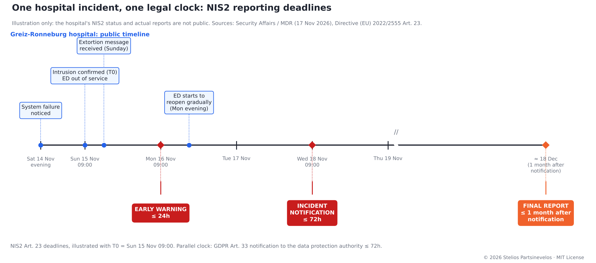
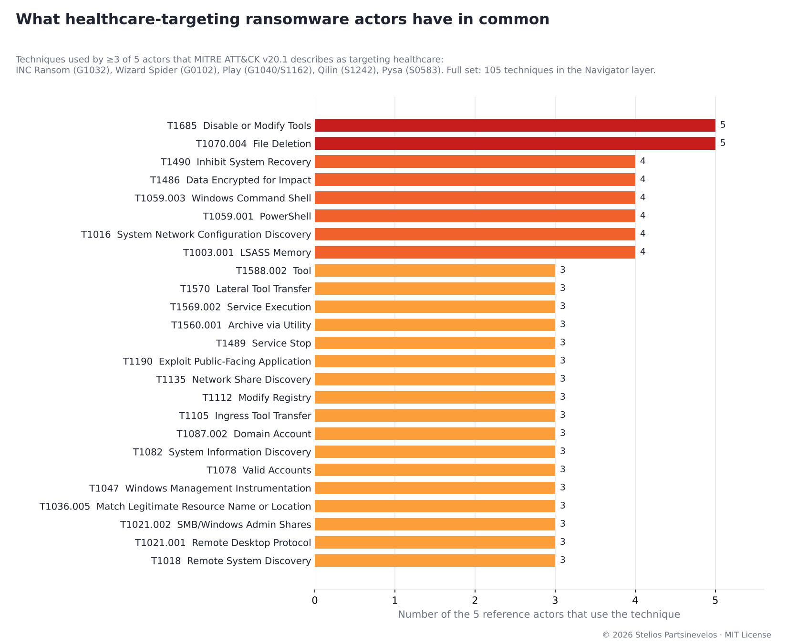

# Hospital Ransomware & NIS2: Incident Response Playbook

**Case study: Greiz-Ronneburg district hospital, Germany (14-16 November 2026)**

An incident response playbook for ransomware and extortion attacks on European hospitals. It includes the **NIS2 24h / 72h / 1-month reporting clock**, ready-to-fill reporting templates, a data-driven **MITRE ATT&CK v20.1** baseline of healthcare-targeting ransomware actors, and **Sigma detections** for the last minutes before encryption.

---

## Why this project

On Saturday evening, 14 November 2026, the Greiz-Ronneburg district hospital in Thuringia noticed a system failure. By Sunday morning its **emergency department was out of service**. Ambulance patients were routed through 112 and the regional dispatch centre in Gera. The district described the attack as an **extortion attempt**, and the extortion message reached the hospital on Sunday. The ED started to reopen gradually on Monday evening, 16 November. The prosecutor's office and the State Criminal Police (LKA) are investigating.

Greiz is not unusual. Healthcare is one of the most attacked essential sectors in Europe, and ransomware causes most of the cyberattacks that disrupt patient care. Since **6 December 2025**, German hospitals have been under the NIS2 implementation law (NIS2UmsuCG / BSIG). That means an incident like this one now comes with a **legal reporting clock**.

This repository answers the practical question a hospital security team faces at T0: **what do we do in the next 24 hours, 72 hours and month, clinically, technically and legally?**

### What is known and not known about Greiz (as of 21 Nov 2026)

| Known | Not (publicly) known |
|---|---|
| System failure noticed Sat 14 Nov evening | Initial access vector |
| ED out of service Sun 15 Nov; extortion message that day | Whether data was encrypted, stolen, or both |
| Patients kept being treated; planned treatments went ahead | Which ransomware group, if any |
| ED gradually reopening from Mon 16 Nov evening | Whether patient data was affected |
| Prosecutor + LKA investigating; police following a specific lead | The hospital's NIS2 classification and reports |

Because the attack chain has not been disclosed, **this project does not invent one**. The ATT&CK layer is a reference baseline built from documented actors, not a reconstruction of Greiz.

---

## Repository contents

| Path | What it is |
|---|---|
| [`playbook/ransomware-ir-playbook.md`](playbook/ransomware-ir-playbook.md) | Six-phase IR playbook (NIST SP 800-61) with clinical + technical tracks, decision points (containment, ED diversion, ransom) and a printable checklist |
| [`playbook/nis2-reporting-timeline.md`](playbook/nis2-reporting-timeline.md) | NIS2 Art. 23 explained for responders, parallel GDPR clock, Germany (BSIG § 32) and Greece (Law 5160/2024) notes, and the Greiz illustration |
| [`templates/`](templates) | Fill-in templates: early warning (24h), incident notification (72h), final report (1 month) |
| [`layers/attack-layer.json`](layers/attack-layer.json) | ATT&CK Navigator layer: 105 techniques, scored by how many of 5 healthcare-targeting actors use them |
| [`detections/sigma/`](detections/sigma) | 9 Sigma files (7 single-event rules + 2 correlation rules) for the pre-encryption window: discovery, data theft and the last minutes before encryption |
| [`detections/splunk_queries.md`](detections/splunk_queries.md) | The same rules converted to Splunk SPL with pySigma |
| `hospital-ransomware-nis2-clock.png` | NIS2 deadlines on the Greiz timeline (illustration) |
| `healthcare-ransomware-top-techniques.png` | Techniques shared by ≥3 of the 5 reference actors |

---

## The NIS2 clock in one table

| Deadline | Report | Key content |
|---|---|---|
| ≤ 24h after awareness | Early warning | Suspected malicious act? Possible cross-border impact? |
| ≤ 72h after awareness | Incident notification | Severity and impact assessment, IoCs |
| ≤ 1 month after notification | Final report | Root cause, mitigations, cross-border impact |
| Parallel: ≤ 72h | GDPR Art. 33 | Personal data breach to the data protection authority |

Full details and national notes: [`nis2-reporting-timeline.md`](playbook/nis2-reporting-timeline.md).

---

## ATT&CK baseline: what healthcare-targeting ransomware actors have in common

**Method.** From the official ATT&CK Enterprise **v20.1** STIX data, I selected every ransomware group or software whose ATT&CK description says it targets healthcare or hospitals and that has technique mappings:

| Actor | ATT&CK ID | ATT&CK description mentions |
|---|---|---|
| INC Ransom | G1032 | industrial, healthcare and education sectors in the US and Europe |
| Wizard Spider | G0102 | ransomware campaigns "ranging from major corporations to hospitals" |
| Play | G1040 (+ Playcrypt S1162) | business, government, critical infrastructure, healthcare, media |
| Qilin | S1242 | manufacturing, technology, financial services, healthcare |
| Pysa | S0583 | finance, government and healthcare organizations |

Each technique's score is the number of these actors that use it, from ATT&CK `uses` relationships (1-5).

**What stands out**
- **All 5** disable or modify security tools (**T1685**, new in ATT&CK v20) and delete files to cover tracks (**T1070.004**).
- **4 of 5** delete shadow copies and backups (**T1490**) before encrypting (**T1486**), and dump LSASS for credentials (**T1003.001**).
- Initial access mixes **valid accounts** (T1078), **exploited public-facing apps** (T1190) and **external remote services** (T1133). These are the reasons MFA and edge patching come first in the playbook's Preparation phase.

Open the layer: [ATT&CK Navigator](https://mitre-attack.github.io/attack-navigator/) → *Open Existing Layer* → *Upload from local* → `layers/attack-layer.json`.

---

## Detections: last-chance tripwires before encryption

The highest-value moment to catch ransomware is **after** the attacker has domain access but **before** the encryptor runs. These rules target the actions that happen in that window:

| Rule | ATT&CK | Level |
|---|---|---|
| Shadow copy / backup catalog deletion | T1490 | critical |
| Mass deployment: shadow copies deleted on 3+ hosts in 10 min (correlation) | T1490 | critical |
| LSASS memory dump via comsvcs or ProcDump | T1003.001 | critical |
| Backup, security or database services stopped | T1489, T1685 | high |
| Windows event log cleared from the command line | T1685.005 | high |
| Shell launched by the PsExec service | T1569.002, T1021.002 | high |
| Burst of AD discovery commands from one account: 4+ in 15 min (correlation) | T1087.002, T1069.002, T1018 | high |
| Data exfiltration to cloud storage with rclone | T1567.002 | high |
| Password-protected archive created (7-Zip / WinRAR) | T1560.001 | medium |

The last three rules cover the **double-extortion** phase: operators map the domain, then steal patient data before they encrypt. Catching them here is cheaper than catching encryption, and the exfiltration rule feeds the **GDPR Art. 33** decision in the playbook.

All rules pass pySigma validation and convert to Splunk SPL. The shadow-copy correlation rule is designed to trigger the network-wide **containment decision** in Phase 3 of the playbook.

---

## Limitations

- **Greiz facts** come from public reporting (Security Affairs, citing MDR) as of 21 Nov 2026. The investigation is ongoing and details may change.
- The **NIS2 timeline illustration** uses an assumed T0. It makes **no claim** about the hospital's classification, reports or compliance.
- The **ATT&CK baseline** reflects what MITRE has mapped for 5 actors. It is not complete, and newer groups active against European hospitals may not be in ATT&CK yet.
- The **Sigma rules** have been syntax-validated and converted, but **not tested against live hospital telemetry**. Tune them before production, especially the service-stop rule.
- This is **not legal advice**. National NIS2 laws differ in forms, portals and details.

---

## Sources

- Security Affairs, *Germany: Greiz Hospital Reopens Emergency Room After Ransom Attack* (17 Nov 2026), citing MDR
- KOMMUNAL, *Hackerangriff auf Krankenhaus Greiz* (17 Nov 2026)
- Directive (EU) 2022/2555 (NIS2), Article 23 and Annex I
- ENISA, *NIS2 incident reporting* infographic
- Germany: NIS2UmsuCG / BSIG (in force 6 Dec 2025)
- Greece: Law 5160/2024 (ΦΕΚ Α' 195/27-11-2024), Article 16; National Cybersecurity Authority reporting guide (cyber.gov.gr)
- MITRE ATT&CK Enterprise v20.1 (STIX data)
- European Policy Centre, *From ransomware to statecraft: Protecting EU healthcare in the new threat landscape* (Nov 2025)
- NIST SP 800-61, *Computer Security Incident Handling Guide*

---

## License & attribution

© 2026 Stelios Partsinevelos. Released under the MIT License (see [LICENSE](LICENSE)).

MITRE ATT&CK® is a registered trademark of The MITRE Corporation; ATT&CK content © The MITRE Corporation. This project is not affiliated with or endorsed by MITRE, the Greiz-Ronneburg hospital, ENISA, the BSI or any authority named. The playbook and rules are provided as-is for defensive and educational use.
